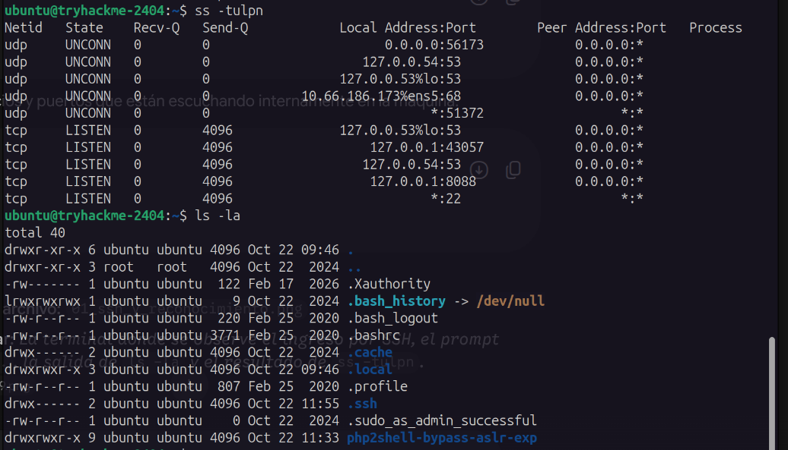
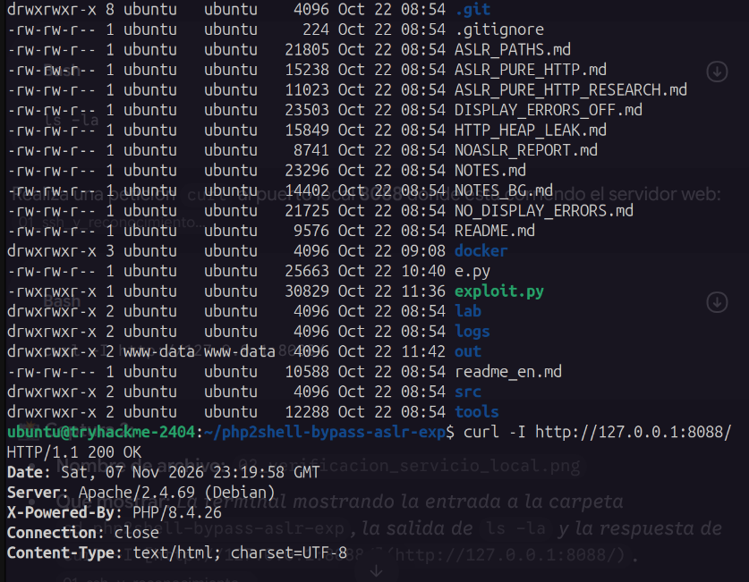
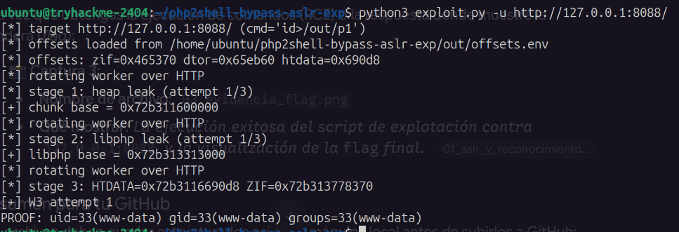
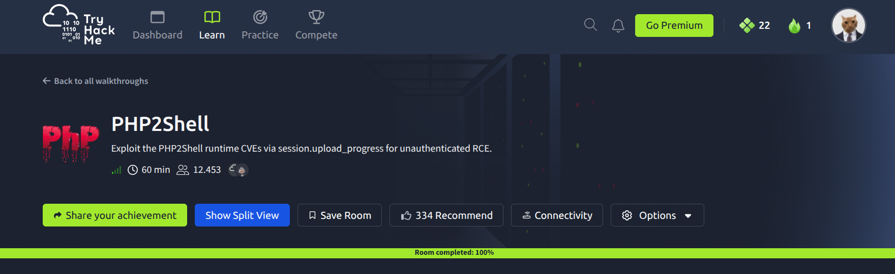

# Reporte de Práctica: CVE-2024-4577 (PHP2Shell) - TryHackMe

## 1. Introducción

En esta práctica se resolvió la sala **CVE: PHP2Shell** de TryHackMe. El objetivo fue revisar los servicios disponibles en la máquina, comprobar el funcionamiento del servicio web y analizar una vulnerabilidad de ejecución remota de comandos (**RCE**) en PHP-CGI, identificada como **CVE-2024-4577**.

La actividad se realizó en un entorno de laboratorio autorizado. Al final, se comprobó que la vulnerabilidad permitía ejecutar comandos en el servidor con los permisos del usuario que ejecutaba el servicio web.

## 2. Evidencias del Proceso

### 2.1 Conexión SSH y Puertos

Primero se realizó la conexión por SSH a la máquina de la sala. Después, se revisaron los puertos locales que estaban en escucha para identificar los servicios disponibles y saber cuál podía ser analizado.



### 2.2 Verificación del Servicio Local

Durante el reconocimiento se comprobó que el servicio web estaba funcionando en el puerto local **8088**. Esta verificación permitió confirmar que había una aplicación web disponible para continuar con el análisis.



### 2.3 Explotación y Prueba de Concepto (PoC)

Para comprobar la vulnerabilidad se ejecutó el script `exploit.py` dentro del entorno de la sala. La prueba demostró que era posible ejecutar comandos en el servidor y obtener una respuesta asociada al usuario `www-data`, que es la cuenta utilizada normalmente por el servicio web.



> **Nota de privacidad:** Por razones de privacidad y buenas prácticas académicas, no se muestra directamente la lectura de la flag ni las respuestas completas de TryHackMe. Esto evita revelar las soluciones de la sala y ayuda a prevenir el plagio. Las capturas se enfocan únicamente en demostrar que el exploit se ejecutó correctamente.

## 3. ¿Cómo funciona esta vulnerabilidad? (CVE-2024-4577)

**CVE-2024-4577** afecta a algunas instalaciones de PHP que utilizan **PHP-CGI** en sistemas Windows. PHP-CGI recibe información de las solicitudes web y puede convertir ciertos datos de la URL en argumentos para el programa PHP.

En determinadas configuraciones regionales de Windows, especialmente las relacionadas con idiomas chino y japonés, se utilizan páginas de códigos ANSI/OEM. Windows aplica una conversión llamada **Best-Fit** para representar algunos caracteres. Durante esa conversión, un carácter especial parecido a un guion puede transformarse en un guion normal (`-`).

El problema aparece cuando PHP-CGI interpreta ese guion como el inicio de un parámetro de línea de comandos. Por ejemplo, el parámetro `-d` permite establecer directivas de configuración de PHP. Un atacante podría enviar una URL especialmente preparada para inyectar opciones como:

```text
-d allow_url_include=1
-d auto_prepend_file=php://input
```

Estas opciones pueden cambiar temporalmente el comportamiento de PHP y hacer que procese contenido controlado por el atacante. Como resultado, el atacante puede conseguir que el servidor ejecute código o comandos con los permisos del proceso PHP-CGI.

De forma resumida, el proceso es:

1. El atacante envía una solicitud HTTP con caracteres especialmente preparados.
2. Windows realiza la conversión Best-Fit según la configuración regional.
3. PHP-CGI interpreta el resultado como argumentos, incluyendo opciones como `-d`.
4. Se modifica la configuración de PHP durante la ejecución.
5. Se puede ejecutar código en el servidor con los permisos del servicio web.

El impacto depende de la versión de PHP, del uso de PHP-CGI, de la configuración de Windows y de los permisos de la cuenta que ejecuta el servicio.

## 4. Recomendaciones

- **Actualizar PHP** a una versión corregida:
  - PHP 8.1.29 o posterior.
  - PHP 8.2.20 o posterior.
  - PHP 8.3.8 o posterior.
- **Evitar PHP-CGI** cuando sea posible y utilizar alternativas como **FastCGI** o **PHP-FPM**.
- **Configurar un WAF** para inspeccionar y bloquear solicitudes con patrones de inyección de argumentos, codificaciones extrañas o intentos de incluir opciones como `-d`.
- Ejecutar el servicio web con una cuenta con los permisos mínimos necesarios.
- Revisar los registros del servidor para detectar solicitudes anormales y procesos inesperados iniciados por PHP.

## 5. Comandos para subir a GitHub

Desde la carpeta principal del proyecto, se pueden ejecutar los siguientes comandos:

```bash
# Crear el repositorio local
git init

# Cambiar el nombre de la rama principal
git branch -M main

# Añadir el README y las imágenes
git add .

# Crear el commit
git commit -m "Añadir informe de práctica PHP2Shell"

# Enlazar el repositorio de GitHub
git remote add origin https://github.com/<usuario>/<repositorio>.git

# Subir los archivos
git push -u origin main
```

Antes de ejecutar `git push`, se debe crear el repositorio en GitHub y reemplazar `<usuario>/<repositorio>` por los datos reales. No se deben subir contraseñas, tokens ni otros datos privados.

## Evidencia de que la máquina está completa

La siguiente captura muestra la evidencia de finalización de la máquina en TryHackMe:


